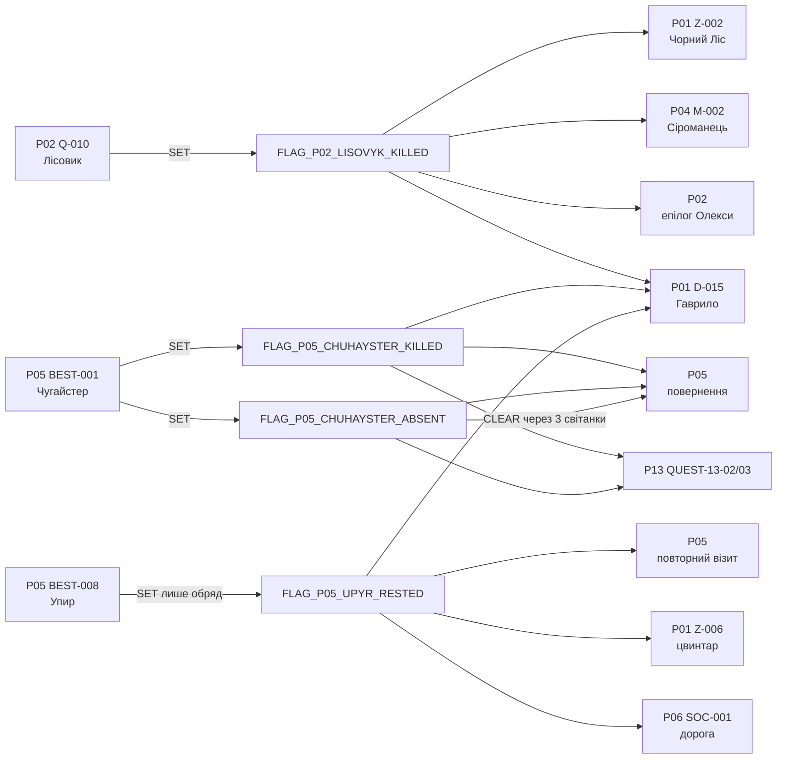

# CROSS-PACKAGE DEPENDENCY MAP
## Граф межпакетных зависимостей трёх сюжетных решений

**Дата:** 2026-11-24
**Флаги:** `FLAG_P02_LISOVYK_KILLED`, `FLAG_P05_CHUHAYSTER_KILLED`, `FLAG_P05_CHUHAYSTER_ABSENT`, `FLAG_P05_UPYR_RESTED`.

---

## 1. Общий граф

---

## 2. Рёбра зависимостей

| № | Источник | Потребитель | Условие | Что меняется | Обратная ветка |
|---:|---|---|---|---|---|
| 1 | P02 Q-010 | P01 Z-002 | `FLAG_P02_LISOVYK_KILLED` | Исчезает «тук-перетук»; лес в тишине; волки ближе; зарубки путаются | Без флага маяк работает |
| 2 | P02 Q-010 | P04 M-002 | `FLAG_P02_LISOVYK_KILLED` | Хведір говорит об осиротевшем лесе; Сіроманець требует двойной данины | Одна данина, обычная сцена |
| 3 | P02 Q-010 | P02, эпілог Олексы | `FLAG_P02_LISOVYK_KILLED` | Нет жетона, нет работы, холод | Жетон/работа/улыбка по фіналу |
| 4 | P02 Q-010 | P01 D-015 | `FLAG_P02_LISOVYK_KILLED` | Гаврило пересказывает слухи об осиротевшем лесе | Гаврило говорит о живом господине |
| 5 | P05 BEST-001 | P05, «Повернення» | `FLAG_P05_CHUHAYSTER_KILLED` | Узнавание, нет повторной награды, бой может повториться | Обычная первая встреча |
| 6 | P05 BEST-001 | P13 QUEST-13-02 | `FLAG_P05_CHUHAYSTER_KILLED` | Иван Бойчук предупреждает о памяти Чугайстера | Обычная легенда |
| 7 | P05 BEST-001 | P13 QUEST-13-03 | `FLAG_P05_CHUHAYSTER_KILLED` | Чугайстер узнаёт игрока, меняет первую реплику | Обычный веселый монолог |
| 8 | P05 BEST-001 | P01 D-015 | `FLAG_P05_CHUHAYSTER_KILLED` | Гаврило говорит о трёх ночах мавок и памяти леса | Говорит о танцующем Чугайстере |
| 9 | P05 BEST-001 | P05, «Повернення» | `FLAG_P05_CHUHAYSTER_ABSENT` | Лес без защитника, мавки сильнее, Чугайстера нет | Чугайстер на месте |
| 10 | P05 BEST-001 | P05, «Повернення» | `FLAG_P05_CHUHAYSTER_ABSENT` CLEAR | Через три рассвета Чугайстер возвращается | — |
| 10a | P05 BEST-001 | P13 QUEST-13-02/03 | `FLAG_P05_CHUHAYSTER_ABSENT` | Сцена откладывается до трёх рассветов; Чугайстера нет | После CLEAR — обычная встреча или память |
| 11 | P05 BEST-008 | P05, «Повторний візит» | `FLAG_P05_UPYR_RESTED` | Сцена не повторяется, могила тихая | Временная победа → возвращение через 3 ночи |
| 12 | P05 BEST-008 | P01 Z-006 | `FLAG_P05_UPYR_RESTED` | Горб осів, ногти не скребут, Навки обходят | Упир ворочается |
| 13 | P05 BEST-008 | P06 SOC-001 | `FLAG_P05_UPYR_RESTED` | Дорога тихая, без смолоскипів | Спешка, огонь, полынь, скрегіт |
| 14 | P05 BEST-008 | P01 D-015 | `FLAG_P05_UPYR_RESTED` | Возы ездят ночью | Возы объезжают балкой |

---

## 3. Прямой и обратный порядок

### 3.1. Естественный порядок для игрока

1. **P01** — игрок слышит «тук-перетук» и видит опасный цвинтар (ещё без решений).
2. **P02** — убивает или щадит Лісовика; ставится `FLAG_P02_LISOVYK_KILLED`.
3. **P04** — Сіроманець и Хведір чувствуют последствия.
4. **P05** — встречает Чугайстера и Упиря; ставит `_KILLED`/`_ABSENT`/`_RESTED`.
5. **P06** — свадьба идёт мимо цвинтаря; проверяется `_RESTED`.
6. **P13** — Чугайстер узнаёт игрока.
7. **P01 (повторный визит)** — Z-002/Z-006 и D-015 показывают новое состояние мира.

### 3.2. Обратный порядок (если игрок пришёл в P05 раньше P02)

- P05 не зависит от P02: Чугайстер и Упир не требуют убийства Лісовика.
- P01 Z-002/Z-006 корректно показывают состояние «флаг не установлен», пока событие не произошло.
- P04 M-002 может быть пройден до P02; тогда проверка `FLAG_P02_LISOVYK_KILLED` даёт обычную ветку. Это допустимо: квест не сломан.
- P13 не зависит от порядка P05/P13; если игрок не убивал Чугайстера, узнавание не срабатывает.

**Вывод:** циклов нет; любая последовательность даёт согласованное состояние.

---

## 4. Матрица конфликтов

| Пара | Тип | Статус |
|---|---|---|
| `FLAG_P02_LISOVYK_KILLED` ↔ «Дар Лісовика» | Взаимоисключающие по сцене | OK: убийство закрывает дар, мирный путь не ставит флаг |
| `FLAG_P05_CHUHAYSTER_KILLED` ↔ `FLAG_P05_CHUHAYSTER_ABSENT` | Не взаимоисключающие, а разные уровни | OK: ставятся вместе, снимается только `_ABSENT` |
| `FLAG_P05_CHUHAYSTER_KILLED` ↔ P13 | Кажущееся противоречие «убит, но говорит» | OK: респаун по канону; P13 учитывает память |
| `FLAG_P05_UPYR_RESTED` ↔ временная победа | Взаимоисключающие исходы | OK: временная победа флаг не ставит |
| `FLAG_P05_UPYR_RESTED` ↔ Навки | Разные сущности | OK: Навки остаются, но обходят горб |
| `FLAG_P05_UPYR_RESTED` ↔ P17 Дунін-Борковський | Омонимия «упир» | OK: не смешиваются, разные регионы |
| `FLAG_P02_LISOVYK_KILLED` ↔ P09 «Чорнолісся» | Возможное географическое наложение | OK: P09 не используется как потребитель, чтобы не отождествлять регионы |
| `FLAG_P02_LISOVYK_KILLED` ↔ P33 «Хуха» | Тематическое наложение | OK: не используется, чтобы не создавать новый субплот |

---

## 5. Правила сохранения состояния

1. Все четыре флага — глобальные, не локальные для сцены.
2. `FLAG_P02_LISOVYK_KILLED`, `FLAG_P05_CHUHAYSTER_KILLED`, `FLAG_P05_UPYR_RESTED` не снимаются.
3. `FLAG_P05_CHUHAYSTER_ABSENT` снимается только по игровому таймеру «три рассвета», не вручную.
4. Переход между пакетами не сбрасывает флаги.
5. Если игрок загружает сохранение до события, флаг отсутствует; если после — присутствует. Отдельного «сброса мира» нет.
6. Флаг не хранит награды и не заменяет инвентарь; награда за Чугайстера проверяется отдельно, чтобы не фармить шерсть.

---

## 6. Сводка по пакетам

| Пакет | Роль | Флаги |
|---|---|---|
| P01 | Потребитель и «мировая память» | Z-002, Z-006, D-015 |
| P02 | Производитель Lisovyk + эпілог | `FLAG_P02_LISOVYK_KILLED` |
| P03 | Проверка входа Q-030, не флаг | ограничение Светлой Дружины |
| P04 | Потребитель Lisovyk | `FLAG_P02_LISOVYK_KILLED` |
| P05 | Производитель Chuhayster/Upyr + потребитель повторного візиту | `_KILLED`, `_ABSENT`, `_RESTED` |
| P06 | Потребитель Upyr | `FLAG_P05_UPYR_RESTED` |
| P13 | Потребитель Chuhayster | `FLAG_P05_CHUHAYSTER_KILLED` |

Остальные 29 пакетов проверены; прямых естественных потребителей для этих трёх решений в них нет без создания нового субплота. Это зафиксировано в `POST_DECISION_VALIDATION_REPORT.md` §3.
